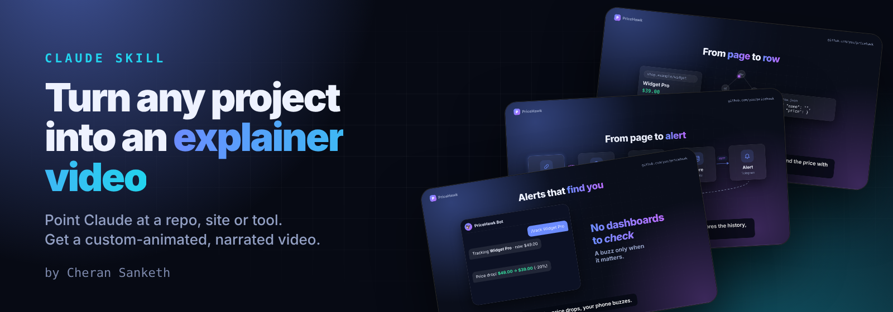
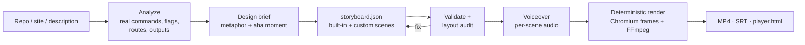
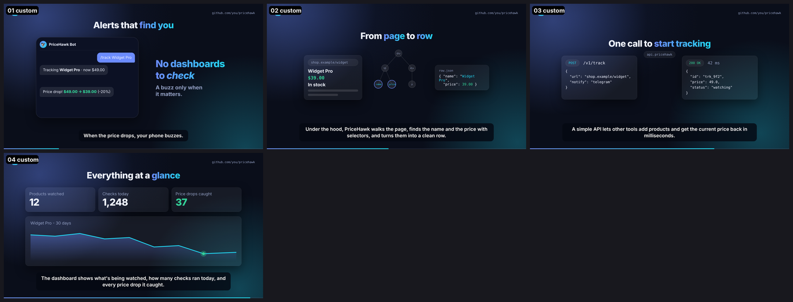
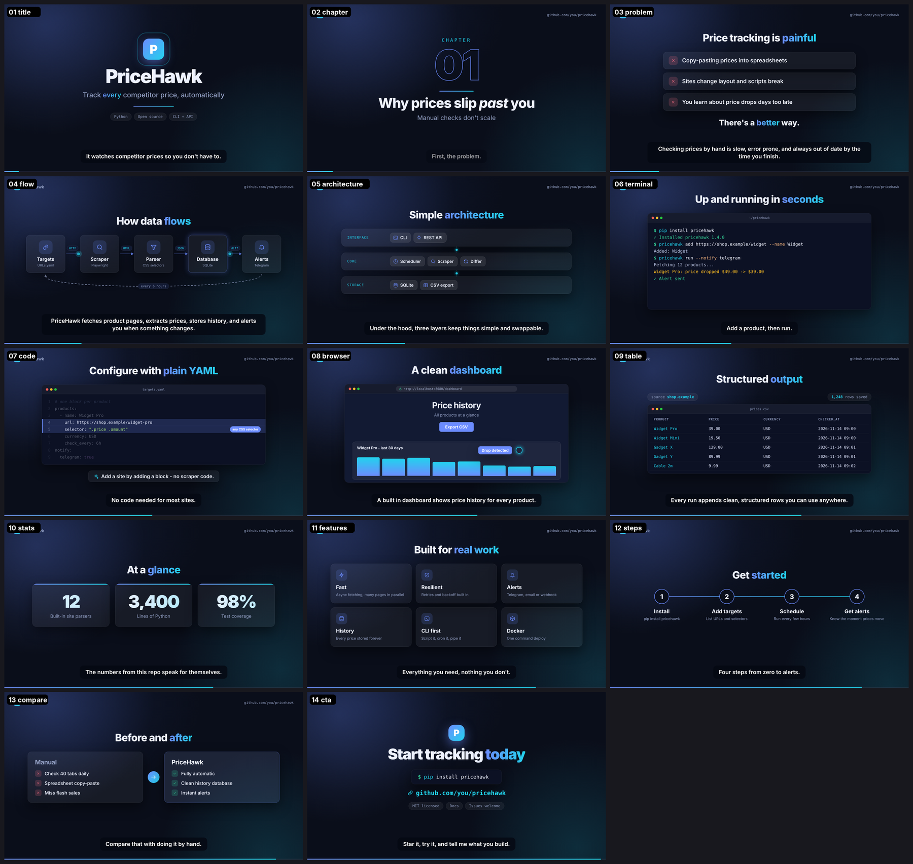

<div align="center">



<br>

# Explainer for Claude

**Point Claude at a repo, a website or a tool. Get a custom-animated explainer video with voiceover, captions and music.**

No templates. No editing software. The animation is designed for what *your* project actually does.

<br>

[](LICENSE)
[](#install)
[](#requirements)
[](#how-it-works)
[](#voiceover)
[](CONTRIBUTING.md)

[Install](#install) · [Use it](#use-it) · [How it works](#how-it-works) · [Voiceover](#voiceover) · [Bespoke animation](#bespoke-animation-not-templates) · [Reference](#reference)

<br>


<sub>A 12-second excerpt from a generated video. Scenes and animations were written for that specific (fictional) project.</sub>

</div>

<br>

## Why

You build scrapers, bots, automations, sites and tools. Explaining them takes a screen recorder, an editor, a script and a weekend. So the work stays invisible.

**Explainer** is a [Claude skill](https://docs.claude.com) that turns that into one sentence:

> *"Make an explainer video for this repo."*

Claude reads your code, works out what the project really does, designs animation that shows it, narrates it, checks its own layout, and renders the video.

## What you get

| | |
|---|---|
| **Video** | MP4 in 16:9 (YouTube, README, website) or 9:16 (Reels, Shorts, TikTok), up to 1080p, with voiceover and music |
| **Captions** | `captions.srt` and burned-in captions, generated from the narration |
| **Script** | `voiceover.txt` with the per-scene narration |
| **Interactive player** | A self-contained `player.html` you can embed on a site, no video hosting needed |
| **Editable source** | `storyboard.json`: change any text, color or scene and re-render in minutes |
| **Poster + GIF** | A thumbnail and a short preview GIF for your README |

## Install

### Claude.ai (web, desktop, mobile)
1. Download [`dist/product-explainer-video.skill`](dist/product-explainer-video.skill).
2. Go to **Settings → Capabilities → Skills** and upload it.
3. Start a new chat and ask for a video.

### Claude Code
```bash
git clone https://github.com/<your-username>/claude-explainer-skill.git
mkdir -p ~/.claude/skills
cp -r claude-explainer-skill/product-explainer-video ~/.claude/skills/
```
Or put it in a project's `.claude/skills/` folder to share it with a team.

### Requirements
Rendering runs on your machine (or Claude's sandbox) and needs no network.

```bash
pip install playwright pillow numpy edge-tts
playwright install chromium
# plus FFmpeg:  brew install ffmpeg  |  sudo apt install ffmpeg
```
`edge-tts` is optional; it gives you free, natural voiceover (see [Voiceover](#voiceover)).

## Use it

Give Claude the project (attach a zip, paste a GitHub URL, a live site URL, or just describe it) and ask:

```text
Make an explainer video for this scraper. Landscape, about 60 seconds, dark theme, brand color #ff6a3d.
```
```text
Make a 30 second vertical video for Reels about my Telegram price-alert bot.
```
```text
Here are my 6 repos. Make one showreel of what I build.
```
```text
Here's my site URL. Make a promo with callouts on the key features, and use a calm male voice.
```

Claude then analyses the project, writes a design brief and storyboard, shows you a preview of every scene, fixes layout problems, and renders. Ask for changes in plain language: *"shorten scene 3", "make it light theme", "add a vertical cut"*.

## How it works



- **Honest by construction.** Commands, flags, routes and numbers come from your code and README, never from imagination. Stats scenes only use measured facts.
- **Deterministic engine.** Every frame is a pure function of time, so renders are reproducible and a scene is previewable as a single still.
- **Self-checking.** A layout audit flags clipped, off-screen or caption-colliding text, and reports errors in custom scene code. Claude looks at a contact sheet of every scene before it spends minutes rendering.

## Voiceover

Narration is generated automatically for every scene (`--voice auto`). Scenes stretch so speech is never cut off, music ducks under the voice, and audio is cached so re-renders are free.

| Engine | Quality | Needs |
|---|---|---|
| **ElevenLabs** | Studio | `ELEVENLABS_API_KEY` |
| **OpenAI TTS** | Excellent | `OPENAI_API_KEY` |
| **Edge neural voices** | Very good, free | `pip install edge-tts` + internet |
| **Piper** | Good, fully offline | `piper` + `PIPER_MODEL=/path/voice.onnx` |
| **macOS `say`** | Decent | macOS |
| **espeak-ng** | Robotic, works anywhere | `espeak-ng` |

`auto` picks the best available, top to bottom, and falls through if one fails. Check yours with:

```bash
python product-explainer-video/scripts/voiceover.py --list
```

Choose a voice with `--voice-name en-US-AndrewNeural` (any engine's voice id), tune pace with `--voice-rate +8%`, skip it with `--voice none`, or supply your own recordings as `scene-01.mp3 … scene-NN.mp3` with `--voice-dir`.

> **Status:** the voiceover pipeline (generation, caching, fallback, scene stretching, mixing) is tested end to end with a built-in test engine. The ElevenLabs, OpenAI, Edge, Piper, `say` and espeak adapters follow each tool's documented interface; please [open an issue](../../issues) if one misbehaves on your setup.

## Bespoke animation, not templates

There is no fixed template. The built-in scenes (title, flow, terminal, code, browser, table, stats, features, steps, compare, architecture, chapter, problem, CTA) are **components**. For the moments unique to your project, Claude writes **custom scenes**: HTML, CSS and animation code made for that product.

<div align="center">

<br><sub>Four custom scenes written from scratch: a bot chat, a scraper's page→DOM→row extraction, an API exchange, and a live metrics dashboard.</sub>
</div>

<br>

A Telegram bot gets a chat conversation. A scraper gets a messy page turning into a clean row. An API gets a request and response. A scheduler gets a clock and events firing. Claude first decides the product's visual metaphor and the "aha" moment, then draws it. See [`references/custom-scenes.md`](product-explainer-video/references/custom-scenes.md) for the authoring API (typewriter, count-up, path drawing, motion along paths, loops, stagger).

<details>
<summary><b>Built-in components</b></summary>
<br>

</details>

## Reference

### Output files
```
explainer-output/
├── <name>.mp4                 the video (H.264 + AAC)
├── <name>-poster.png          thumbnail
├── <name>.gif                 12-second preview (with --gif)
├── player.html                interactive, embeddable player
├── captions.srt               subtitles
├── voiceover.txt              narration script
├── voice/                     per-scene audio + cache manifest
└── storyboard.resolved.json   final storyboard with computed timings
```

### Scripts (all in `product-explainer-video/scripts/`)
| Script | Purpose |
|---|---|
| `analyze_project.py` | Extract verified facts from repos/folders/URLs: commands, flags, routes, domains, outputs, CI, real stats |
| `capture_site.py` | Screenshot a live site and collect page facts |
| `storyboard.py` | Validate a storyboard and print the timing plan |
| `render_video.py` | Layout audit, `--contact-sheet`, `--still`, and the full render |
| `voiceover.py` | Generate per-scene narration audio |
| `make_music.py` | Generate a royalty-free music bed |

### Render options
```bash
python render_video.py storyboard.json --contact-sheet        # preview every scene + layout audit
python render_video.py storyboard.json --still 12.5,40        # full-res frames at given seconds
python render_video.py storyboard.json --quality final --gif  # 1080p, 30 fps
python render_video.py storyboard.json --vertical --mood upbeat --voice-name en-US-AndrewNeural
```
Quality presets: `draft` 960×540 · `standard` 1280×720 · `final` 1920×1080. Frames render in parallel (`--workers N`).

### Project structure
```
.
├── product-explainer-video/       the skill (copy this folder into ~/.claude/skills/)
│   ├── SKILL.md                   workflow Claude follows
│   ├── scripts/                   analyzer, renderer, voiceover, music, validator
│   ├── assets/engine/             animation engine (CSS + JS)
│   ├── assets/examples/           reference storyboards (inspiration, not templates)
│   ├── references/                schema, narrative playbook, custom-scene guide
│   └── evals/                     test prompts
├── dist/product-explainer-video.skill
└── docs/assets/                   images used in this README
```

## FAQ

**Is it really not a template?** The engine ships components, but Claude composes the video per project and writes custom scenes for what is unique. The skill instructs it never to reuse an example's structure or wording.

**Can Claude invent features?** The skill forbids it. Commands, flags and numbers must come from your code, README or you, and layout/stat rules back that up. Still, review the storyboard before publishing; you know your project best.

**How long does rendering take?** It captures real frames. As a guide, a 48 s, 720p video took about 4 minutes on a single CPU core; more cores and `--workers` speed it up. Use `draft` to preview quickly.

**Why is there no voice in Claude.ai?** Voice engines like Edge need internet access, which Claude's sandbox may not have. The video still renders with music and you get the script. Run it in Claude Code locally, or set an API key, to add the voice.

**Can I use my own voice or music?** Yes: `--voice-dir` for recordings, `--music file.mp3` for a track.

**Does it record my screen?** No. It draws motion graphics. For real interfaces, it uses screenshots (captured automatically for live sites) or draws the UI.

## Roadmap
- [ ] Word-level caption highlighting synced to speech
- [ ] More voice engines (Azure, Google, local Kokoro)
- [ ] Per-scene sound effects
- [ ] Brand kit file (logo, colors, fonts) applied across videos
- [ ] 1:1 square output

## Contributing
Contributions are welcome: voice adapters, scene components, bespoke recipes, bug reports. Start with [CONTRIBUTING.md](CONTRIBUTING.md).

## License
[MIT](LICENSE) © 2026 Cheran Sanketh

<div align="center">
<br>
<sub>Built by <b>Cheran Sanketh</b> · Designed to make great projects easier to understand</sub>
</div>
